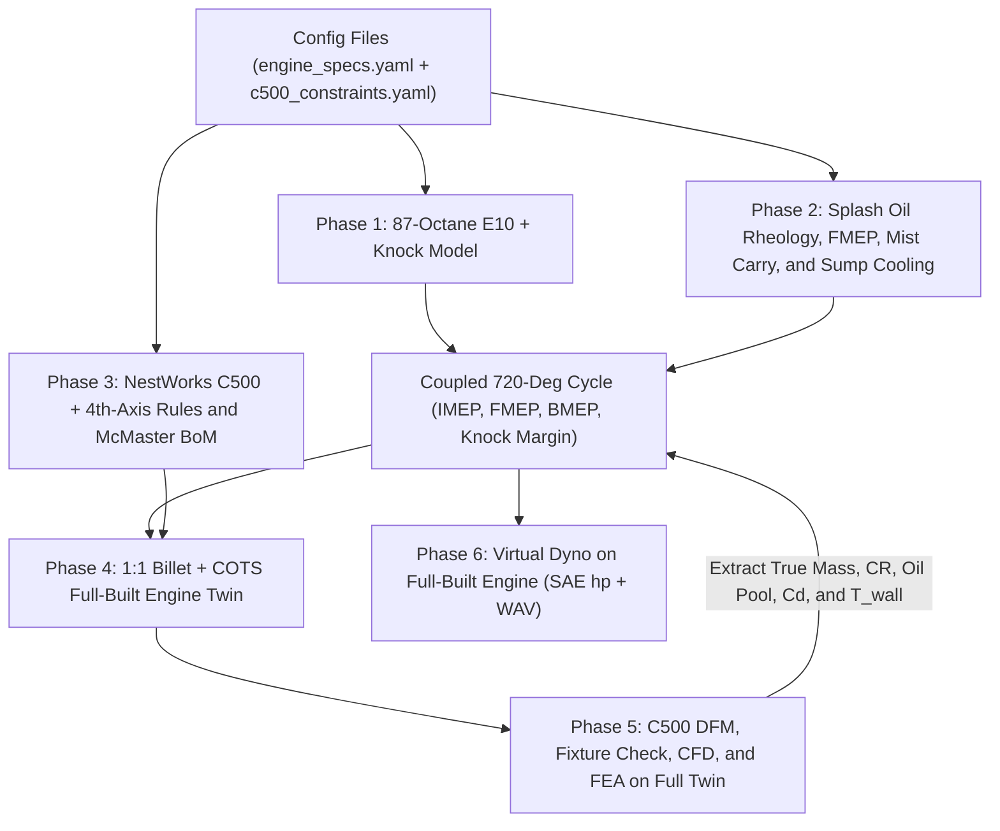

# OpenEngine-1C Plan for 87-Octane Fuel, Splash Oil, and NestWorks C500 CNC Hardware

This plan upgrades OpenEngine-1C into a build-ready, 1:1 scale (`196.1 cc`) billet engine tailored to the **NestWorks C500 CNC with 4th-Axis Rotary Module**. It adds US 87-octane knock limits, wet-sump splash lubrication, McMaster-Carr hardware, and explicit fallbacks if the 4th-axis rotary is unavailable.

> [!IMPORTANT]
> This plan locks `1.0x` scale, wet-sump splash oil, McMaster hardware, and **NestWorks C500 + 4th-Axis Rotary** limits.

---

## Phase 1: US 87-Octane (AKI 87 E10) Fuel and Knock Simulation

Current modules mix pure 100-octane iso-octane in [`combustionProperties`](../cases/openfoam_combustion/constant/combustionProperties) with methane in [`CanteraThermochemistry`](../src/openengine/thermo/cantera_kinetics.py). Air-cooled aluminum heads run hot. Consequently, a `9.8:1` compression ratio risks end-gas knock on US 87-octane E10 pump gas.

### Planned Simulation Changes
1. **Expand fuel configuration.** Add a `fuel` block to [`engine_specs.yaml`](../config/engine_specs.yaml) with `aki: 87.0`, `ethanol_pct: 10.0`, `lhv_j_kg: 42.0e6`, and `stoich_afr: 14.1`.
2. **Replace methane kinetics.** Update [`CanteraThermochemistry`](../src/openengine/thermo/cantera_kinetics.py) to load a Primary Reference Fuel mechanism (`C8H18`, `n-C7H16`, and `C2H5OH`).
3. **Predict end-gas knock.** Create `src/openengine/thermo/knock.py` using an adiabatic unburned zone and a Livengood-Wu knock integral.
4. **Couple knock into cycle sweeps.** Add knock checks to [`FourStrokeSimulator`](../src/openengine/thermo/gas_exchange.py) to select a safe compression ratio and spark advance.
5. **Update 3D CFD fuel properties.** Set E10 stoichiometry and flame speed coefficients in [`thermophysicalProperties`](../cases/openfoam_combustion/constant/thermophysicalProperties) and [`combustionProperties`](../cases/openfoam_combustion/constant/combustionProperties).

---

## Phase 2: Wet-Sump Splash Lubrication, Friction (FMEP), and Cooling

Today, [`bearing.py`](../src/openengine/dynamics/bearing.py) only solves isothermal Ocvirk film thickness in `HydrodynamicBearing` using fixed `OilProperties`. We lock **Wet-Sump Splash-Dipper + Rolling Bearings** to eliminate high-tolerance pump pockets and cross-drilled gasket galleries.

### Planned Lubrication Modules (`src/openengine/lubrication/`)
1. **Temperature-viscosity rheology (`rheology.py`).** Implement Walther and Vogel equations for `SAE 10W-40` and `SAE 20W-50` oils from `20 C` to `140 C`.
2. **Mechanical friction (`friction.py`).** Compute Friction Mean Effective Pressure (FMEP) across four zones:
   - Piston ring pack and skirt mixed-hydrodynamic Stribeck friction.
   - Main ball bearing and crankpin needle-roller bearing drag.
   - SOHC cam-lobe and rocker-pivot boundary friction using loads from [`SOHCCamshaft`](../src/openengine/dynamics/sohc_cam.py).
   - Connecting-rod dipper hydrodynamic impact and crank windage loss.
3. **Brake output coupling.** Subtract FMEP from NIMEP in [`FourStrokeSimulator`](../src/openengine/thermo/gas_exchange.py) and [`cli.py`](../src/openengine/cli.py) to report BMEP, Brake Power, and BSFC.
4. **Splash and drain-back transport (`splash.py`).** Size static sump depth (`4-6 mm` dipper immersion), wall throw velocity, timing-chain oil carry, and gravity return flow.
5. **Thermal oil balance (`thermal.py`).** Balance bearing friction, dipper churning, and piston-splash heat against finned-sump air cooling. Feed oil cooling into [`PistonFeaConfig`](../src/openengine/fea/piston.py) and [`ChtCoolingConfig`](../src/openengine/cfd/cht_cooling.py).

---

## Phase 3: NestWorks C500 Constraints and McMaster-Carr BoM

New file `config/c500_constraints.yaml` codifies exact **NestWorks C500 + 4th-Axis Rotary** hardware limits (with a `has_fourth_axis: true` flag):

| C500 Parameter | Machine Spec | Mandatory Engine Design Rule |
| :--- | :--- | :--- |
| **ATC XY Envelope** | `190 x 210 mm` | Keep every flat-mounted housing under `165 x 185 mm`. |
| **Z Clearance** | `160 mm` max | Bolt parts to a low fixture plate and split the sump pan (`Z <= 55 mm`). |
| **4th-Axis Rotary** | `100 mm` OD x `175 mm` | Machine coaxial parts (`<= 95 mm` OD) on the rotary. |
| **Max Tool Shank** | `6.35 mm` (`1/4 in`) | Cap single-side pocket depth at `35 mm` and corner radii at `>= 1.6 mm`. |
| **800 W / 18k RPM** | High speed, low torque | Thread-mill all threads (`M6-M20`). Use `7075-T6` rod and `1144` webs. |
| **MQL Air-Mist** | Exposed linear rails | Ban abrasive cast-iron milling. Use pre-honed steel liner tubing. |

### Purchased Hardware Strategy (McMaster-Carr + Powersports)

> [!TIP]
> Pre-honed McMaster steel cylinder tubing eliminates both `115 mm` deep-bore chatter and abrasive cast-iron dust on the C500 linear rails.

| Sourcing Channel | Purchased Components |
| :--- | :--- |
| **McMaster Fasteners & Seals** | Class 10.9 screws, studs, dowels, Viton shaft seals, Viton O-rings, sight glass, magnetic drain plug, and breather vent. |
| **McMaster Drive & Bearings** | `6206` main ball bearings, crankpin needle bearing, `#25` roller chain, sprockets, and chrome-silicon valve springs. |
| **McMaster Raw Metal Stock** | Pre-honed steel liner tube, ground `4140` shafting, `6061-T6` and `7075-T6` billet, `4032` bar, `1144` steel, and bronze. |
| **Powersports Vendor** | `68 mm` piston ring set, M10 spark plug (`CMR7H`), `26 mm` slide carburetor, and 12V Hall-sensor CDI kit. |

---

## Phase 4: 1:1 Billet CAD, Oil Service, and 4th-Axis Dependency Ledger

### 4.1 Easy Oil-In, Level-Check, and Oil-Out Crankcase + Bolt-On Sump Pan
1. **Bolt-On Sloped Sump Pan.** Split the wet sump into a separate `35 mm` tall bottom pan with an O-ring seal. This split keeps crankcase halves well below the `160 mm` C500 Z limit.
2. **Easy Oil Fill.** Thread-mill a `45-deg` angled `M20x1.5` O-ring fill boss high on the right crankcase wall for funnel-free pouring.
3. **Instant Level Check.** Thread-mill a flat boss on the sump side for a McMaster Viton glass sight window centered at the static dipper line.
4. **Clean Gravity Drain.** Mill a `4-deg` sloped floor inside the sump pan leading to a side-exit `M12x1.5` magnetic O-ring drain plug.
5. **Breather and Return.** Route SOHC cam oil back to the sump through the vertical chain tunnel, and vent blow-by through a sintered-bronze breather.

### 4.2 Part-by-Part Machining Plan and 4th-Axis Requirement Ledger

The table below flags every component that **strictly requires** the 4th-axis rotary and defines the fallback if the shop omits the rotary module:

| Component & Module | C500 Machining Mode | Requires 4th Axis? | Fallback Without 4th-Axis Rotary |
| :--- | :--- | :--- | :--- |
| **Poppet Valves** ([`cylinder_head.py`](../src/openengine/cad/cylinder_head.py)) | Continuous 4-axis radial peeling from bar | **YES (Required)** | Buy COTS `5 mm` stem valves (`30 mm` / `26 mm`). |
| **One-Piece Camshaft** (`valvetrain_hardware.py`) | Continuous 4-axis lobe milling (`4140` bar) | **YES (Required)** | Mill flat `2.5D` lobes and key/press onto ground shaft. |
| **Bronze Guides & Steel Seats** (`valvetrain_hardware.py`) | Continuous 4-axis coaxial turning (`<= 35 mm` OD) | **YES (Required)** | Buy COTS guides/seats or ream 3-axis interpolated sleeves. |
| **3-Ring Piston** ([`piston.py`](../src/openengine/cad/piston.py)) | 4-axis OD + flat-endmill ring grooving (`68 mm` OD) | **Strongly Preferred** | 3-axis soft-jaw flip + `1/4 in` T-slot groove cutter. |
| **Trigger Wheel & Retainers** (`covers_and_aux.py`) | 4-axis indexed teeth and coaxial tapers | **Preferred** | 3-axis two-sided dowel-pinned fixture plate ops. |
| **Cylinder Head** ([`cylinder_head.py`](../src/openengine/cad/cylinder_head.py)) | 3-axis table (`130 mm > 100 mm` chuck) + angle plate | **No** (`> 100 mm`) | Native 3-axis fixture plate + `15-deg` sine block. |
| **Finned Barrel** ([`cylinder_block.py`](../src/openengine/cad/cylinder_block.py)) | 3-axis table (`120 mm` width) + `1/4 in` keyseat fins | **No** (`> 100 mm`) | Native 3-axis 4-side flip around shrunk-in honed tube. |
| **Split Crankcase & Sump Pan** (`crankcase.py`) | 3-axis low-profile fixture plate (`<= 55 mm` Z) | **No** (`> 100 mm`) | Native 3-axis two-sided `2.5D` pocketing. |
| **`7075-T6` Split Con-Rod** ([`connecting_rod.py`](../src/openengine/cad/connecting_rod.py)) | 3-axis `2.5D` pocketing + split cap + dipper tang | **No** | Native 3-axis `2.5D` pocketing + hand ream. |
| **3-Piece Crankshaft** ([`crankshaft.py`](../src/openengine/cad/crankshaft.py)) | 3-axis `2.5D` `1144` steel webs + ground `4140` pins | **No** | Native 3-axis `2.5D` profile + arbor press assembly. |

### 4.3 Off-the-Shelf Models, Sub-Assemblies, and Full-Built Digital Twin

We import McMaster STEP models (`assets/cots_step/`) and build parametric powersports envelopes (`src/openengine/cad/cots_parts.py`) for screws, bearings, seals, chains, spark plug, carburetor, fan, and wrench zones. Instead of one flat group in [`assembly.py`](../src/openengine/cad/assembly.py), `src/openengine/cad/assemblies/` builds five hierarchical assemblies:
1. **`rotating_assembly.py`.** Mates the 3-piece crank, needle bearing, split rod, bolts, piston, rings, pin, circlips, `6206` bearings, and flywheel. Computes true rotating and reciprocating mass for crank balancing.
2. **`head_assembly.py`.** Mates the billet head, guides, seats, valves, seals, springs, retainers, cam tower, cam, rockers, cover, `CMR7H` plug, and screws. Computes exact chamber clearance volume and valvetrain mass.
3. **`crankcase_assembly.py`.** Mates case halves, dowels, sump pan, seals, O-rings, sight glass, plugs, breather, and an `SAE 10W-40` oil-pool solid. Verifies oil capacity and BDC dipper submergence at the sight-glass center.
4. **`dressed_engine_assembly.py` (Full-Built Test Target).** Mates all sub-assemblies with the liner, barrel, chain, carburetor, fan shroud, fasteners, oil pool, and fuel charge. Runs Boolean collision checks across every part and wrench zone. Exports toggleable 3D layers to [`dashboard.py`](../src/openengine/reporting/dashboard.py).
5. **`c500_fixture_assemblies.py`.** Mounts each stock block onto the C500 fixture plate or `100 mm` rotary chuck to verify Z and clamp clearance.

---

## Phase 5: NestWorks C500 DFM Validator, Setup Sheets, and Full-Twin Verification

> [!WARNING]
> Switching the rod to `7075-T6` aluminum and using straight-bored head ports changes rod stress, crank balance, and port flow ($C_d$). Phase 5 re-verifies all three on the full-built `dressed_engine_assembly`.

1. **Automated C500 DFM Validator (`src/openengine/dfm/c500_check.py`).** Verify every B-Rep part and fixture assembly against C500 limits:
   - 3-axis table parts fit inside `165 x 185 x 55 mm`.
   - 4th-axis rotary parts fit inside `95 mm` diameter by `165 mm` length.
   - Single-side pocket depths stay `<= 35 mm`, internal corner radii stay `>= 1.6 mm`, and threads match standard thread-mill pitches.
   - Report exact fallback switches when `has_fourth_axis` equals `false`.
2. **2D Setup Sheets (`src/openengine/dfm/drawings.py`).** Export SVG and DXF views with datum pins, thread-mill specs, `H7/p6` shrink fits, and hand-ream callouts.
3. **Full-Built Multi-Physics Acceptance Suite.** Extract true component masses, flywheel inertia, chamber compression volume, fastener preloads, and sump oil volume directly from `dressed_engine_assembly`. Re-run [`port_bench.py`](../src/openengine/cfd/port_bench.py), [`combustion.py`](../src/openengine/cfd/combustion.py), [`piston.py`](../src/openengine/fea/piston.py), and [`connecting_rod.py`](../src/openengine/fea/connecting_rod.py) against the full-built, oiled, and fueled engine. Add `openengine lub`, `openengine dfm-check`, and `openengine bom` to [`cli.py`](../src/openengine/cli.py).

---

## Phase 6: Virtual Dynamometer, Brake Horsepower, and Exhaust Audio

Right now, [`gas_exchange.py`](../src/openengine/thermo/gas_exchange.py) evaluates only one speed (`5500 RPM`). Phase 6 runs `src/openengine/dyno/` directly against the full-built, lubricated, and 87-octane-fueled `dressed_engine_assembly` to measure true shaft brake horsepower and synthesize real exhaust sound.

### Planned Virtual Dyno Modules (`src/openengine/dyno/`)
1. **Steady-State Brake Sweep (`steady_sweep.py`).** Sweep `1400` to `7000 RPM` across throttle settings with 1D Helmholtz runner tuning. Auto-tune spark advance at each speed for Maximum Brake Torque without 87-octane knock. Report **SAE J1349 Brake Horsepower (`hp` and `kW`)**, **Brake Torque (`lb-ft` and `N-m`)**, mechanical efficiency, and a 2D BSFC fuel map.
2. **Transient Inertia Pull (`inertia_pull.py`).** Integrate angular acceleration of [`flywheel.py`](../src/openengine/dynamics/flywheel.py) plus a virtual roller drum from `2000` to `7000 RPM`. Track head temperature rise, oil viscosity warm-up, and 3-piece crank press-fit slip margin during a `10-second` pull.
3. **Exhaust Audio Synthesis (`audio.py`).** Generate a `44.1 kHz` `.wav` audio clip of the pull and overrun decel from the exhaust blowdown pulse and tailpipe resonance.
4. **Dashboard Dyno Cell and CLI.** Embed interactive horsepower curves, BSFC contours, and an HTML5 audio player in [`dashboard.py`](../src/openengine/reporting/dashboard.py). Add `openengine dyno` to [`cli.py`](../src/openengine/cli.py).

---

## Execution Order and Verification Gates

| Step | Deliverable | Verification Gate |
| :--- | :--- | :--- |
| **Step 1** | Phase 1 87-octane E10 kinetics + knock | `pytest tests/test_knock_87aki.py` passes knock-free CR and spark map. |
| **Step 2** | Phase 2 splash oil rheology, FMEP, dipper carry, sump thermal | `pytest tests/test_lubrication.py` verifies BMEP, BSFC, and `T_oil <= 130 C`. |
| **Step 3** | Phase 3 `c500_constraints.yaml` + McMaster BoM + `7075-T6` material | `pytest tests/test_c500_bom.py` validates C500 envelopes and COTS interfaces. |
| **Step 4** | Phase 4 billet CAD, COTS models, 5 sub-assemblies, oiled/fueled full twin | `pytest tests/test_cad_billet_assembly.py` verifies zero part, fastener, or wrench collisions. |
| **Step 5** | Phase 5 C500 DFM check, setup sheets, full-twin CFD/FEA | `openengine dfm-check` and `openengine run-all` pass on `dressed_engine_assembly`. |
| **Step 6** | Phase 6 virtual dyno on full-built oiled/fueled twin + exhaust WAV | `pytest tests/test_virtual_dyno.py` and `openengine dyno` output SAE hp curve and `.wav` audio. |
