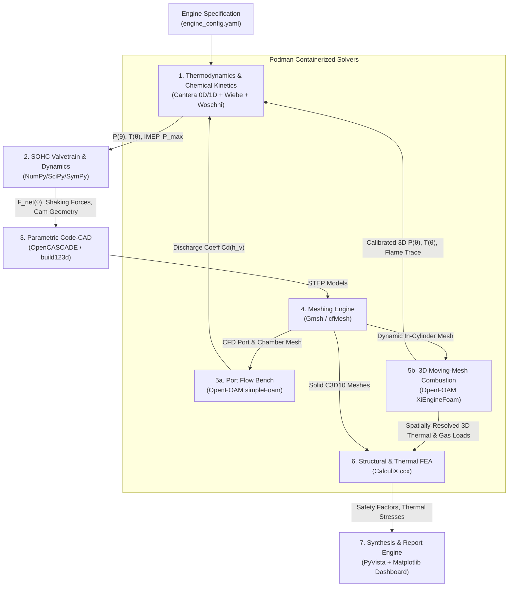
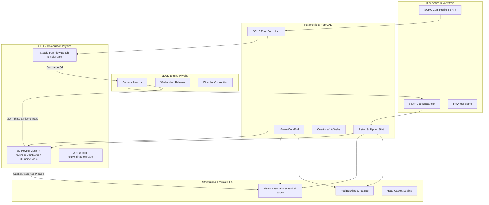
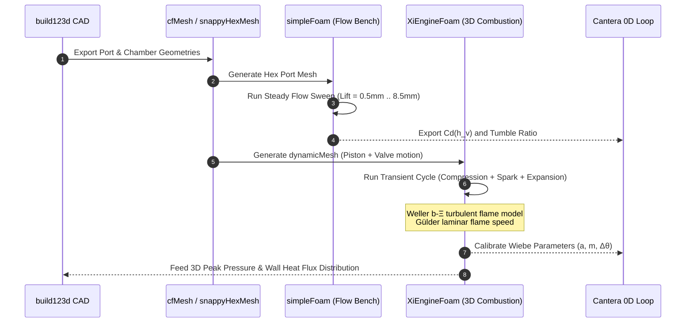
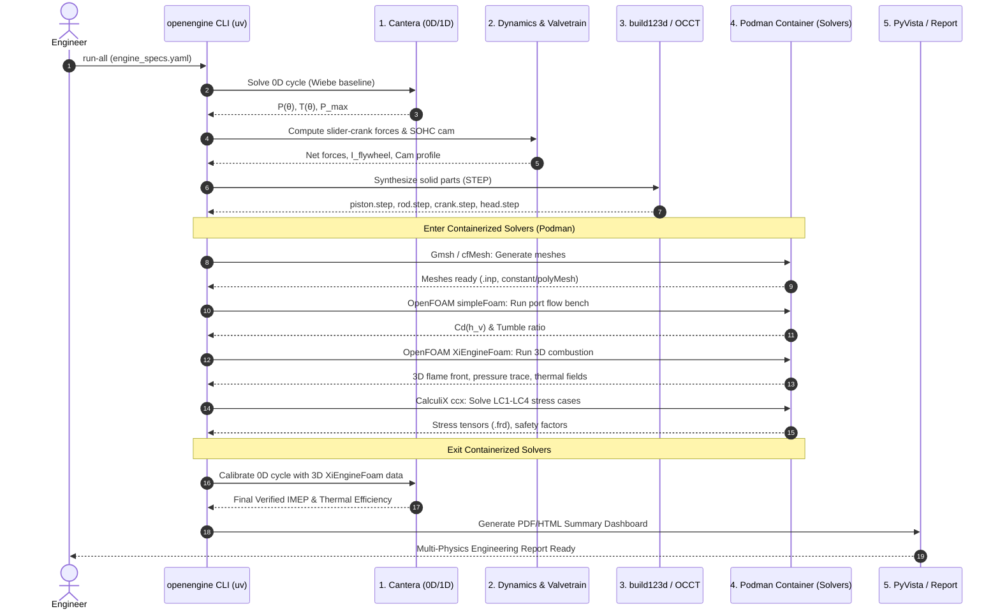
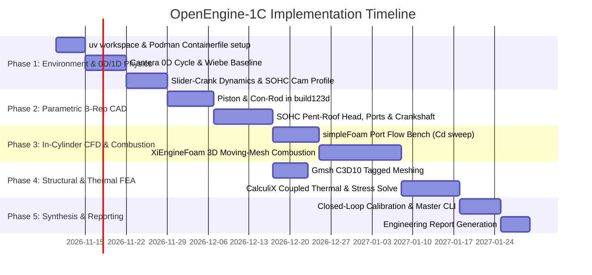

# OpenEngine-1C: Master Engineering Plan & Technical Specification

> **A 100% Open-Source, Code-First Design, Simulation, and Geometric Modeling Pipeline for a Single-Cylinder, Four-Stroke SOHC Engine with In-Cylinder Combustion CFD**

---

## 1. Executive Summary & Vision

The objective of **OpenEngine-1C** is to build a fully reproducible, programmatic design and multi-physics verification pipeline for a single-cylinder, four-stroke internal combustion engine (ICE). Rather than relying on closed, proprietary CAD/CAE software suites, this project establishes an end-to-end automated engineering pipeline built entirely on **battle-tested open-source software**.

### Core Architecture Principles
1. **Continuous Parameter Flow:** Engineering starts with 0D thermodynamic chemistry; thermodynamic loads dimension the structural geometry; parametric geometry feeds 3D CFD and FEA; 3D combustion and port flow physics loop back to calibrate 0D assumptions.
2. **SOHC Pent-Roof Architecture:** An Overhead Camshaft (SOHC) configuration with a steep downdraft intake port produces strong tumble motion, maximizing turbulent flame speed during combustion.
3. **Early 3D Combustion Modeling:** In-cylinder reacting flow and flame front propagation are treated as primary design drivers, using OpenFOAM's dynamic moving-mesh combustion solver (**`XiEngineFoam`**).
4. **Deterministic BoM (Python + Containers):** Python dependencies are locked with **`uv`**, while the native C++ solvers (OpenFOAM, CalculiX, Gmsh) are containerized and version-pinned with **`podman`**.



---

## 2. Technical Stack & Bill of Materials (BoM)

### 2.1 Python Toolchain (`uv`)
The Python environment handles orchestration, 0D thermodynamics, mechanism dynamics, B-Rep CAD synthesis, meshing control, and post-processing. All dependencies are strictly pinned in `pyproject.toml` and locked via `uv.lock`.

```toml
# pyproject.toml
[project]
name = "openengine-1c"
version = "0.1.0"
description = "Programmatic design, thermodynamic simulation, and CAD/CFD/FEA pipeline for a 1-cylinder 4-stroke SOHC engine"
readme = "README.md"
requires-python = ">=3.11,<3.13"
dependencies = [
    # 1. Thermodynamics, Kinetics & Numerics
    "cantera>=3.0.0",
    "numpy>=1.26.0",
    "scipy>=1.12.0",
    "sympy>=1.12.0",
    "polars>=0.20.0",
    # 2. Geometric Modeling (Open CASCADE Python Wrapper)
    "build123d>=0.6.0",
    "cadquery-ocp>=7.7.2",
    # 3. Meshing & Scientific I/O
    "gmsh>=4.13.1",
    "meshio>=5.3.5",
    "pyvista>=0.43.0",
    "trimesh>=4.3.0",
    # 4. CFD Utilities & Process Management
    "pyfoam>=2023.7",
    # 5. CLI & Reporting
    "pydantic>=2.7.0",
    "pyyaml>=6.0.1",
    "typer>=0.12.0",
    "rich>=13.7.0",
    "matplotlib>=3.8.0",
]

[build-system]
requires = ["hatchling"]
build-backend = "hatchling.build"
```

### 2.2 Containerized Native Solvers (`podman`)

To guarantee bitwise reproducibility across machines and avoid complex host toolchain conflicts, the non-Python engineering solvers are compiled into a rootless Podman image (`openengine-solvers:latest`).

```dockerfile
# Containerfile (Podman)
FROM docker.io/opencfd/openfoam-default:2406

USER root
ENV DEBIAN_FRONTEND=noninteractive

# Install CalculiX (ccx) and Gmsh
RUN apt-get update && apt-get install -y --no-install-recommends \
    calculix-ccx \
    gmsh \
    libgomp1 \
    libglu1-mesa \
    libgl1-mesa-glx \
    curl \
    && rm -rf /var/lib/apt/lists/*

# Add openengine runner script
WORKDIR /workspace
ENTRYPOINT ["/bin/bash", "-c"]
```

#### Podman Execution Pattern:
Python scripts invoke native solvers via an isolated Podman runner:
```python
# src/openengine/infra/podman.py
import subprocess


def run_solver(command: str, workspace_dir: str):
  cmd = [
      "podman",
      "run",
      "--rm",
      "-v",
      f"{workspace_dir}:/workspace:Z",
      "-w",
      "/workspace",
      "openengine-solvers:latest",
      f"source /usr/lib/openfoam/openfoam2406/etc/bashrc && {command}",
  ]
  return subprocess.run(cmd, check=True, capture_output=True, text=True)
```

| Solver | Image / Version | Role in OpenEngine-1C |
| :--- | :--- | :--- |
| **OpenFOAM** | v2406 (OpenCFD) | Port flow bench (`simpleFoam`), moving-mesh combustion (`XiEngineFoam`), and air-cooling fin conjugate heat transfer (`chtMultiRegionFoam`). |
| **CalculiX (`ccx`)** | v2.21+ | Implicit structural analysis (bending, buckling, preloads) and steady-state thermal conduction. |
| **Gmsh** | v4.13+ | Discretizes OpenCASCADE STEP solids into high-order tetrahedral (`C3D10`) meshes with boundary tag injection. |
| **Open CASCADE (OCCT)** | v7.8 / v7.9 | Exact analytical and NURBS geometry synthesis via `build123d`. |

---

## 3. Baseline Engine Specification: 200cc SOHC

The reference architecture is a high-efficiency, air-cooled, single-overhead-camshaft motorcycle/kart engine:

| Parameter | Symbol | Target Value | Engineering Rationale |
| :--- | :--- | :--- | :--- |
| **Displacement** | $V_d$ | $196.1\text{ cm}^3$ | Benchmark displacement ($B = 68.0\text{ mm}$, $S = 54.0\text{ mm}$). |
| **Bore / Stroke Ratio** | $B/S$ | $1.26$ (Over-square) | Short stroke keeps mean piston speed low at high RPM and accommodates larger valves. |
| **Connecting Rod Length**| $L$ | $108.0\text{ mm}$ | $\lambda = r/L = 0.25$ ($L/r = 4.0$) minimizing piston side thrust. |
| **Compression Ratio** | $r_c$ | $9.8 : 1$ | Enabled by the modern pent-roof chamber and central spark plug. |
| **Valvetrain Layout** | — | **SOHC (Chain-Driven)** | Single overhead camshaft with roller-tipped rocker arms. |
| **Combustion Chamber** | — | **Pent-Roof** | Included valve angle $\sim 30^\circ$, steep downdraft intake, central spark plug. |
| **Rated Speed / Redline** | $N$ | $5500\text{ RPM} / 7000\text{ RPM}$ | SOHC eliminates pushrod flex, allowing high-RPM breathing. |
| **Cooling Method** | — | Forced Air-Cooled | Perimeter radial fins with optimized spacing. |

---

## 4. Subsystem Modules & Technical Specifications



---

### Module 1: Thermodynamics & Chemical Kinetics (0D / 1D)

* **Tool:** **Cantera** (via Python API).
* **Physics & Governing Equations:**
  1. **Reactor Dynamics:** Modeled as an open, variable-volume system with methane or iso-octane surrogate mechanisms:
     $$\frac{dU}{dt} = -P \frac{dV}{dt} + \sum \dot{m}_{in} h_{in} - \sum \dot{m}_{out} h_{out} - \dot{Q}_{wall}$$
  2. **Volume Function:**
     $$V(\theta) = V_c + \frac{V_d}{2} \left[ (R - 1) + 1 - \cos\theta + \sqrt{R^2 - \sin^2\theta} \right]$$
  3. **Combustion Model:** Initialized with an empirical Wiebe model, then replaced/calibrated by the 3D `XiEngineFoam` mass fraction burned curve.
  4. **Woschni Heat Loss:** Spatially-averaged convective heat loss to the piston, head, and liner:
     $$h_c(\theta) = 3.26 \cdot B^{-0.2} \cdot P(\theta)^{0.8} \cdot T(\theta)^{-0.55} \cdot w(\theta)^{0.8}$$
* **Deliverables:** Baseline indicator loop ($P-\theta$), $P_{max} \approx 7.0 - 8.0\text{ MPa}$, initial thermal boundary conditions.

---

### Module 2: SOHC Valvetrain, Dynamics & Balancing

#### 2.1 Slider-Crank Dynamics
* Exact piston kinematics:
  $$x(\theta) = r \left( (1 - \cos\theta) + \frac{1}{\lambda} \left(1 - \sqrt{1 - \lambda^2 \sin^2\theta}\right) \right)$$
* Primary and secondary reciprocating forces:
  $$F_{inertia}(\theta) \approx - m_{recip} \cdot r \omega^2 (\cos\theta + \lambda \cos 2\theta)$$
* Combined pin force $F_{net}(\theta) = P(\theta) A_p + F_{inertia}(\theta)$.
* Single-cylinder balancing: 100% rotating mass + 50% reciprocating mass counterbalanced on crank webs to minimize resultant shaking vectors.
* Flywheel inertia sized for speed fluctuation $C_s \le 0.035$ at idle and rated speed.

#### 2.2 SOHC Camshaft Synthesis
* Cam lobes drive rocker arms directly on the cylinder head.
* **4-5-6-7 Polynomial Motion Law:** Guarantees zero velocity, zero acceleration, and zero jerk at cam opening and closing boundaries:
  $$y(\phi) = h_{max} \left[ 35 \left(\frac{\phi}{\phi_0}\right)^4 - 84 \left(\frac{\phi}{\phi_0}\right)^5 + 70 \left(\frac{\phi}{\phi_0}\right)^6 - 20 \left(\frac{\phi}{\phi_0}\right)^7 \right]$$
* Valve spring rate calculated with a minimum $30\%$ safety margin against valve float at $1.2 \times$ redline ($8400\text{ RPM}$).

---

### Module 3: Parametric B-Rep CAD (build123d / Open CASCADE)

The entire engine geometry is defined programmatically in Python using `build123d`.

```
src/openengine/cad/
├── piston.py          # Crown, ring pack, pin bosses, slipper skirt
├── connecting_rod.py  # Small end, I-beam shank, split big end, rod bolts
├── crankshaft.py      # Journals, crankpin, counterweight webs, timing sprocket
├── cylinder_block.py  # Cast iron sleeve, aluminum barrel, cooling fins
├── cylinder_head.py   # SOHC pent-roof chamber, ports, valve guides, cam tower
└── assembly.py        # Mates parts into master STEP assembly
```

#### SOHC Head & Chamber Specifics:
1. **Pent-Roof Combustion Chamber:**
   * Roof angle: $15^\circ$ intake side, $15^\circ$ exhaust side ($30^\circ$ included angle).
   * Central spark plug boss situated directly at the apex for minimum flame travel distance.
2. **Steep Downdraft Intake Port:**
   * High-tumble runner angled at $28^\circ$ relative to the cylinder axis.
   * Cross-sectional area smoothly tapers toward the valve seat to maintain intake air velocity ($60 - 80\text{ m/s}$ at rated speed).
3. **Piston Slipper Skirt:**
   * Modern short-skirt design lightened to reduce reciprocating mass ($m_{recip}$).
   * Ovality and barrel profile generated mathematically to ensure uniform contact patch under operating temperature.

---

### Module 4: CFD & 3D In-Cylinder Combustion (OpenFOAM)

Combustion is the heart of the engine's physics. This module is executed inside the Podman container.



#### 4.1 Steady Port Flow Bench (`simpleFoam`)
* **Objective:** Extract the flow discharge coefficient $C_d(h_v)$ and barrel tumble index over the valve lift envelope.
* **Solver:** `simpleFoam` with $k-\omega\text{ SST}$ turbulence model.
* **Boundary Conditions:** $\Delta P = 28\text{ in. H}_2\text{O} \approx 7.0\text{ kPa}$ depression at the cylinder boundary.
* **Tumble Ratio Integration:**
  $$\Omega_{tumble} = \frac{\int (\mathbf{r} \times \mathbf{u}) \cdot \mathbf{e}_{transverse} \, dm}{I_{transverse} \cdot \omega_{engine}}$$

#### 4.2 3D Moving-Mesh In-Cylinder Combustion (`XiEngineFoam`)
* **Objective:** Directly resolve spark ignition, turbulent flame front propagation, in-cylinder pressure rise, and unburnt-to-burnt gas transitions on a moving mesh.
* **Mesh Motion (`dynamicMeshDict`):**
  * Solver uses `engineMesh` with topological deformation driven by the slider-crank kinematics:
    * `bore: 0.068`, `stroke: 0.054`, `conRodLength: 0.108`, `rpm: 5500`.
  * Time-stepping is crank-angle-based (`engineTime`) at $\Delta \theta = 0.1^\circ\text{ CA}$.
* **Combustion Modeling ($b-\Xi$ Model):**
  * Tracks progress variable $b$ ($b=0$ unburnt fuel-air mixture, $b=1$ fully burnt products):
    $$\frac{\partial (\rho b)}{\partial t} + \nabla \cdot (\rho \mathbf{u} b) = \nabla \cdot \left( \frac{\mu_{eff}}{Sc_t} \nabla b \right) + \rho_u S_u \Xi |\nabla b|$$
  * Flame wrinkling factor $\Xi$ models turbulence-flame interaction based on local turbulent kinetic energy ($k$) and dissipation ($\varepsilon$ or $\omega$).
  * Laminar flame speed $S_u$ computed dynamically via **Gülder's correlation** based on local instantaneous pressure and unburnt gas temperature.
* **Spark Ignition Model:**
  * Modeled as a localized thermal and progress variable source term activated at $\theta_{spark} = -22^\circ\text{ BTDC}$ in a $1.5\text{ mm}$ spherical volume at the spark plug gap.
* **Coupling & Validation:**
  * Produces true 3D spatial pressure and temperature fields.
  * Mass fraction burned curve $x_b(\theta)$ from OpenFOAM directly calibrates Cantera's 0D Wiebe parameters.

#### 4.3 Air-Cooling Conjugate Heat Transfer (`chtMultiRegionFoam`)
* Couples conduction through the aluminum head and block with external cooling airflow.
* Enforces peak cylinder head temperature $< 210^\circ\text{C}$ around the exhaust valve seat.

---

### Module 5: Finite Element Analysis (Gmsh + CalculiX)

Executed inside the Podman container:

* **Meshing (`gmsh`):** STEP geometry converted to quadratic tetrahedra (`C3D10`) with automatic physical group boundary tagging.
* **Structural Solvers (`ccx`):**
  1. **LC-1: Firing TDC (Mechanical):** Peak gas pressure $P_{max} = 7.8\text{ MPa}$ applied to the piston crown, reacted through the wrist pin. Yield safety factor $> 1.6$.
  2. **LC-2: Coupled Thermo-Mechanical:** Spatially resolved temperature field from `XiEngineFoam` mapped onto the piston crown; solves thermal expansion and hot skirt-to-liner clearance.
  3. **LC-3: Connecting Rod Buckling:** Euler-Johnson critical load check on the I-beam shank under peak firing load ($F_{max} \approx 28.3\text{ kN}$). Safety factor $n_{buckle} \ge 2.5$.
  4. **LC-4: Head Bolt Preload & Sealing:** $4\times$ M8 Grade 10.9 bolts preloaded to $22\text{ kN}$; verifies uniform gasket pressure $> 35\text{ MPa}$ under peak pressure.

---

## 5. Automated Pipeline Orchestration

The entire design and simulation pipeline is unified through the `openengine` CLI:

```bash
# 1. Lock and sync Python dependencies
$ uv sync

# 2. Build the Podman solver container
$ podman build -t openengine-solvers:latest -f Containerfile .

# 3. Run the complete pipeline
$ uv run openengine run-all --config config/engine_specs.yaml
```

### Pipeline Execution Architecture



---

## 6. Directory Structure & Repository Layout

```text
openengine-1c/
├── .python-version             # Pinned Python version (3.12)
├── pyproject.toml              # uv project specification
├── uv.lock                     # Cryptographic lockfile
├── Containerfile               # Podman image (OpenFOAM 2406, ccx, gmsh)
├── config/
│   ├── engine_specs.yaml       # Master dimensions (Bore, Stroke, CR, RPM)
│   ├── materials.yaml          # Al4032, 4340 Steel, Cast Iron properties
│   └── simulation_flags.yaml   # Mesh density, convergence thresholds
├── src/
│   └── openengine/
│       ├── __init__.py
│       ├── cli.py              # Typer CLI entrypoint
│       ├── infra/
│       │   └── podman.py       # Podman container runner wrapper
│       ├── thermo/
│       │   ├── cycle.py        # Cantera reactor network
│       │   ├── woschni.py      # Wall heat transfer model
│       │   └── gas_exchange.py # Valve orifice flow equations
│       ├── dynamics/
│       │   ├── slider_crank.py # Kinematic motion & balance calculations
│       │   ├── flywheel.py     # Torque integration & inertia sizing
│       │   └── sohc_cam.py     # 4-5-6-7 polynomial valvetrain profile
│       ├── cad/
│       │   ├── base.py         # Open CASCADE / build123d wrappers
│       │   ├── piston.py       # Parametric slipper piston generator
│       │   ├── connecting_rod.py # I-beam rod generator
│       │   ├── crankshaft.py   # Counterweighted crankshaft generator
│       │   ├── cylinder_head.py# SOHC pent-roof head & port generator
│       │   └── assembly.py     # Full engine assembly compound
│       ├── meshing/
│       │   ├── gmsh_fea.py     # Gmsh STEP-to-C3D10 converter
│       │   └── cfmesh_runner.py# cfMesh / snappyHexMesh automation
│       ├── cfd/
│       │   ├── port_bench.py   # simpleFoam automation & Cd extraction
│       │   ├── combustion.py   # XiEngineFoam moving-mesh case generator
│       │   └── cht_cooling.py  # chtMultiRegionFoam fin heat rejection
│       ├── fea/
│       │   ├── calculix.py     # ccx input deck generator (.inp)
│       │   ├── load_cases.py   # Thermal, buckling, and firing cases
│       │   └── post_fea.py     # .frd result parser & stress extractor
│       └── reporting/
│           ├── dashboard.py    # PyVista 3D render + Matplotlib generator
│           └── templates/      # Jinja2 / HTML engineering summary templates
├── cases/
│   ├── openfoam_port_flow/     # Template OpenFOAM port bench case
│   ├── openfoam_combustion/    # Template XiEngineFoam moving-mesh case
│   └── openfoam_cht_cooling/   # Template conjugate heat transfer case
├── tests/
│   ├── test_thermo.py
│   ├── test_kinematics.py
│   └── test_cad_export.py
└── outputs/                    # Git-ignored simulation artifacts (STEP, VTK, PDF)
```

---

## 7. Phased Implementation Roadmap



### Phase 1: Environment Setup & 0D/1D Physics Engine
* **Milestone 1.1:** Scaffold `uv` workspace and verify the Podman `Containerfile` builds with OpenFOAM 2406, `ccx`, and `gmsh`.
* **Milestone 1.2:** Implement Cantera 0D variable-volume reactor with Wiebe heat release and Woschni heat loss.
* **Milestone 1.3:** Implement slider-crank dynamics, $50\%$ rotating/reciprocating balancing, and the 4-5-6-7 polynomial SOHC cam profile.

### Phase 2: Parametric B-Rep CAD Library
* **Milestone 2.1:** Implement `piston.py` and `connecting_rod.py` in `build123d`, directly reading dimensions from Phase 1.
* **Milestone 2.2:** Model the SOHC cylinder head with a $30^\circ$ included angle pent-roof chamber, central spark plug boss, and $28^\circ$ downdraft intake port.
* **Milestone 2.3:** Export watertight STEP files and verify assembly clearance.

### Phase 3: In-Cylinder CFD & 3D Reactive Combustion
* **Milestone 3.1:** Automate `simpleFoam` steady port sweeps across 10 valve lifts; output $C_d(h_v)$ and tumble ratio.
* **Milestone 3.2:** Configure `XiEngineFoam` with dynamic `engineMesh` motion, Gülder laminar flame speed, and Weller $b-\Xi$ turbulent flame front tracking.
* **Milestone 3.3:** Run transient closed-valve compression, spark ignition (at $-22^\circ\text{ CA}$), and flame expansion; extract in-cylinder pressure and temperature fields.
* **Milestone 3.4:** Feed the 3D burn rate back to calibrate Cantera's 0D model.

### Phase 4: Structural & Thermal FEA Verification
* **Milestone 4.1:** Generate quadratic tetrahedral meshes (`C3D10`) via Gmsh with automatic boundary surface identification.
* **Milestone 4.2:** Apply mapped 3D combustion temperature and pressure distributions onto the piston crown; solve coupled thermal-mechanical stress in CalculiX.
* **Milestone 4.3:** Evaluate connecting rod buckling and high-cycle fatigue safety factors.

### Phase 5: Closed-Loop Integration & Dashboard
* **Milestone 5.1:** Bind all phases into `openengine run-all`.
* **Milestone 5.2:** Generate an automated multi-physics engineering verification report with PyVista 3D stress renders, flame front visualizations, and $P-V$ indicator loops.

---

## 8. Verification & Acceptance Criteria

| Subsystem | Metric | Acceptance Target |
| :--- | :--- | :--- |
| **Thermodynamics** | Indicated Specific Fuel Consumption (ISFC) | $220 - 260\text{ g/kWh}$ |
| **Thermodynamics** | Peak Firing Pressure ($P_{max}$) | $7.0 - 8.2\text{ MPa}$ |
| **Valvetrain** | Valve Float Margin | $> 30\%$ at $1.2 \times$ redline ($8400\text{ RPM}$) |
| **CAD Engine** | B-Rep Validity | Watertight (manifold), zero open wires, STEP AP214/AP242 compliant |
| **CFD Ports** | Peak Discharge Coefficient ($C_{d\_max}$) | $\ge 0.65$ at maximum valve lift ($h_v / D_v \approx 0.25$) |
| **CFD Combustion** | 10%–90% Mass Fraction Burn Duration | $20^\circ - 28^\circ\text{ CA}$ |
| **FEA Piston** | Minimum Safety Factor (Fatigue / Yield) | $SF \ge 1.6$ at operating temperature |
| **FEA Con-Rod** | Critical Buckling Safety Factor | $SF_{buckle} \ge 2.5$ under peak firing load |
